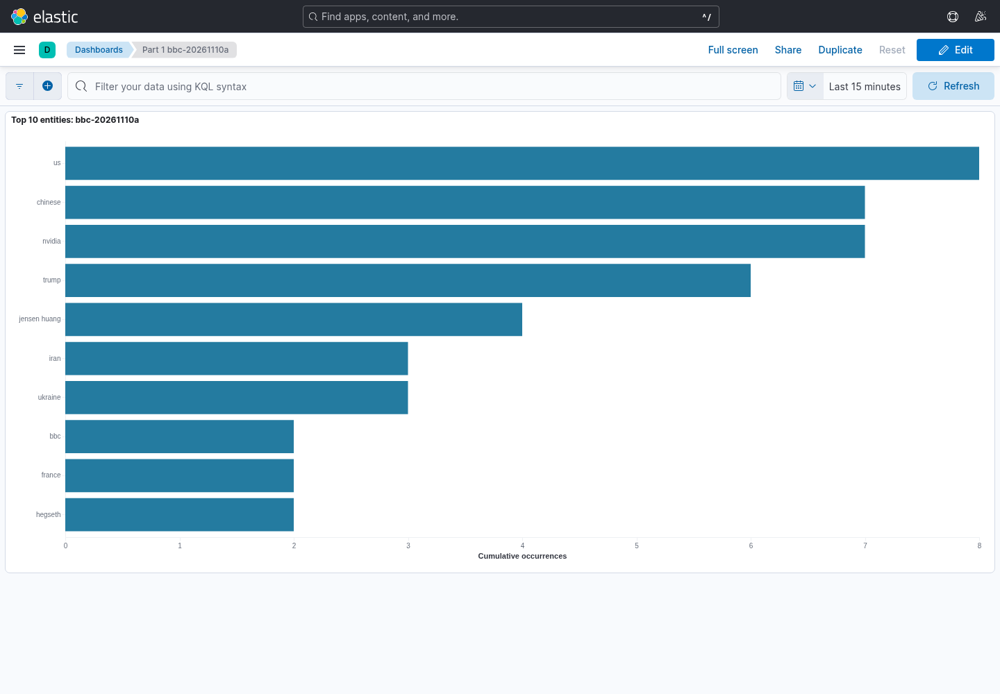
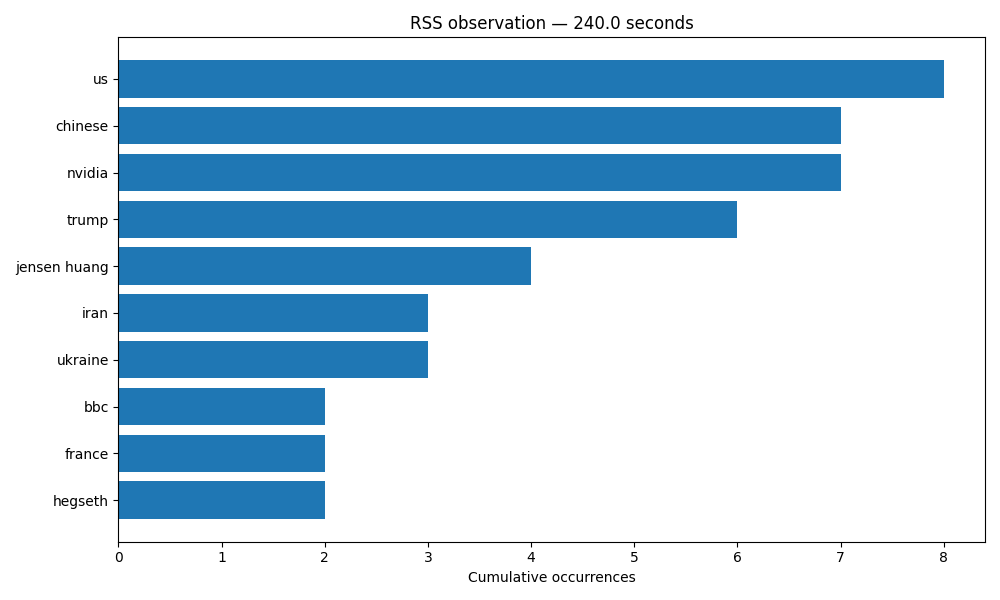

# CS 6350 Assignment 3 — Part 1 results

## Evidence and source

This resumed session collected real BBC World News RSS data. Earlier-session results described in the supplied context were controlled tests only. They were not reused as news observations. New controlled tests and their screenshots are retained separately under validation/.

Source: https://feeds.bbci.co.uk/news/world/rss.xml. The producer fetched titles and summaries approximately once per minute, stripped markup and normalized whitespace. No article pages were downloaded. BBC returned HTTP 200 in this environment; the original connection failure was not reproduced. The initial response and headers are preserved under validation/connectivity/.

Collection began 2026-11-10T04:24:18.936340+00:00; the last dashboard capture was 2026-11-10T04:30:26.798483+00:00 (UTC offsets shown). In America/Chicago this is Nov 09, 2026 10:24:18 PM CST through Nov 09, 2026 10:30:26 PM CST. The targets were 2, 4 and 6 minutes, rather than the assignment’s illustrative 15/30/45/60-minute schedule. Actual timestamps and elapsed times are below. This is a short live-source development experiment.

The audit contains 31 unique acknowledged articles. The first successful poll acknowledged 31 existing feed entries; later completed polls acknowledged 0 additional articles. There were 6 completed polls and 0 poll errors. These totals describe ingestion, not instantaneous processing. Feed article publication times range from 2026-11-08T00:48:59+00:00 to 2026-11-10T04:09:16+00:00, so the initial backlog substantially predates this six-minute run.

## Extraction and counting

Python 3.12, Java 21, PySpark 4.0.1/Scala 2.13 and spaCy 3.8.7 with en_core_web_sm 3.8.0 were used. Accepted labels: PERSON, ORG, GPE, LOC, NORP, FAC, EVENT, PRODUCT, WORK_OF_ART, LAW, LANGUAGE. Dates, times and numerical quantities are excluded. Entity text is case-folded and whitespace-normalized; aliases are not merged. Every occurrence counts, including multiple mentions in an article. Titles and summaries are combined.

The producer remembers Kafka-acknowledged stable GUID/URL hashes in SQLite. Spark independently deduplicates article IDs using checkpointed state and maintains cumulative counts by entity text and label. Complete snapshots use version=batch_id+1. Logstash upserts latest documents by run/entity/label with external_gte versions, and historical documents by run/batch/entity/label. The chart sums latest counts across labels for one run, never across historical cumulative snapshots. Duplicate/retry and checkpoint behavior were tested with separate controlled inputs.

## Observations

| Target | Actual elapsed (s) | Count export time (UTC) | Dashboard capture (UTC) | Batch | Rows / expected rows |
| --- | ---: | --- | --- | ---: | ---: |
| 2 min | 120.070 | 2026-11-10T04:26:20.830585+00:00 | 2026-11-10T04:26:31.339697+00:00 | 0 | 77 / 77 |
| 4 min | 240.024 | 2026-11-10T04:28:18.474260+00:00 | 2026-11-10T04:28:26.583956+00:00 | 0 | 77 / 77 |
| 6 min | 360.026 | 2026-11-10T04:30:18.476912+00:00 | 2026-11-10T04:30:26.798483+00:00 | 0 | 77 / 77 |

Each export passed the historical-batch completeness check. The timestamps identify separate captures; an unchanged batch is expected when no new input arrives. Kibana screenshots were captured from the rendered dashboard after checking positive SVG bar geometry. The global UI time picker is not part of this Vega query; the chart represents the selected run’s cumulative counts.

| Entity | Observation 1 | Observation 2 | Observation 3 |
| --- | ---: | ---: | ---: |
| us | 8 | 8 | 8 |
| chinese | 7 | 7 | 7 |
| nvidia | 7 | 7 | 7 |
| trump | 6 | 6 | 6 |
| jensen huang | 4 | 4 | 4 |
| iran | 3 | 3 | 3 |
| ukraine | 3 | 3 | 3 |
| bbc | 2 | 2 | 2 |
| france | 2 | 2 | 2 |
| hegseth | 2 | 2 | 2 |

### Observation 1: 120.1 seconds

[CSV counts](results/bbc-20261110a/snapshot-01.csv) · [JSON metadata and counts](results/bbc-20261110a/snapshot-01.json)

### Observation 2: 240.0 seconds

[CSV counts](results/bbc-20261110a/snapshot-02.csv) · [JSON metadata and counts](results/bbc-20261110a/snapshot-02.json)

### Observation 3: 360.0 seconds

[CSV counts](results/bbc-20261110a/snapshot-03.csv) · [JSON metadata and counts](results/bbc-20261110a/snapshot-03.json)

## Interpretation and limits

The leading term was “us” (8 mentions), followed by “chinese” and “nvidia” (7 each), “trump” (6), and “jensen huang” (4). This reflects recurring subjects in the sampled BBC titles and summaries, including several entries concerning Nvidia and Jensen Huang. It measures mentions in this small feed sample; it does not establish the importance, truth, sentiment or public reception of individual reports.

All three exported count sets were identical. The initial poll supplied the data; later polls discovered no new article IDs. This is valid cumulative behavior, not evidence of continued new reporting at the same rate. Stories were not duplicated to make the plots change.

The final snapshot contains 77 entity/label pairs and 111 total occurrences. Recomputing extraction from all 31 unique audited source texts matched the final exported counts exactly (source-count-reconciliation.json). The final snapshot’s committed source end offsets are retained separately. These checks support final processing coverage; they do not make the ingestion total a processed-article total at every earlier moment.

Limitations include spaCy recognition and label errors, unresolved aliases such as surnames versus full names, repeated title/summary wording, a single RSS feed’s editorial selection, a small backlog-driven sample, and ingestion/processing/indexing/capture delays. Revisions to an existing article GUID are not reprocessed. Counts are cumulative rather than sliding-window counts. Unbounded ID and aggregation state are suitable only for a bounded coursework run without a production retention design. Entity frequency does not establish sentiment or public opinion.

## Runtime and reproducibility

Docker image extraction failed with a no-space error in the cloud’s rootless Docker store. The successful run used checksum-verified official local distributions of Kafka 3.9.1 and Elasticsearch/Kibana/Logstash 8.17.0 via local_stack.py. The provided Compose configuration parses, but actual Compose startup was not validated. README.md documents both setups and a full-length experiment command. requirements.lock.txt records the installed Python environment. All service ports were bound to loopback.

Controlled checks passed for producer acknowledgement and SQLite restart deduplication; entity occurrence counts; duplicate IDs across micro-batches; Spark checkpoint restart; replay-safe indexing; and actual rendered Kibana bars. See validation/STATUS.md. The old session’s unavailable binary plots were not recovered; the supplied controlled and live images were newly captured during this session.

## Final implementation audit

A follow-up audit fixed capture overwriting when resuming an experiment. Two actual
controlled runner sessions then confirmed that the same checkpoint/run/topics can
be resumed while preserving the original PNG/CSV/JSON/Kibana screenshot bytes,
continuing capture numbering and retaining both sessions in the report. A separate
sink test confirmed that a stale snapshot cannot overwrite a newer Elasticsearch
count. Five unit/regression tests pass, and the tested dependency lock is now the
installer's default. See validation/STATUS.md for evidence and the remaining
Docker startup limitation. The BBC observation evidence above is unchanged.
