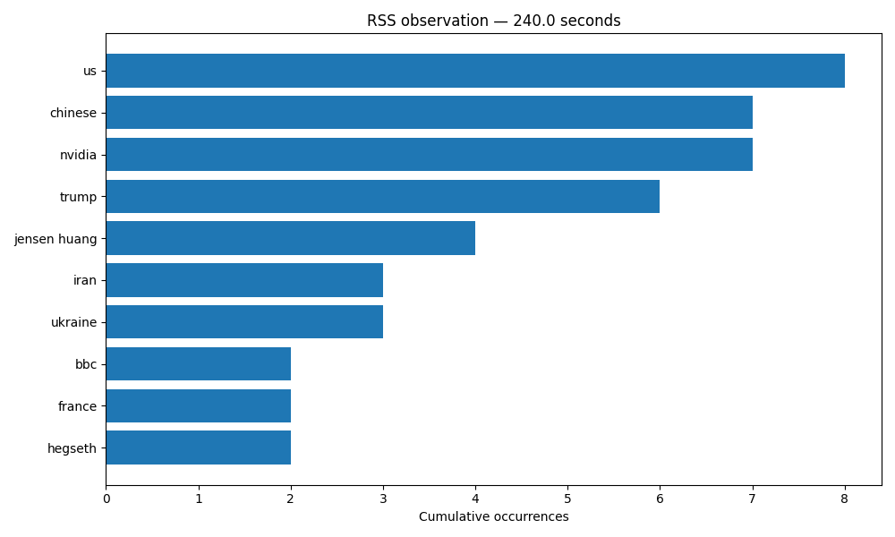

# RSS observations

Source: https://feeds.bbci.co.uk/news/world/rss.xml
Runner started: 2026-11-10T04:24:18.450171+00:00

Elapsed times include startup and indexing delays. Counts are cumulative, not sliding-window counts. The first RSS poll includes existing feed backlog.

## Observation 1: 120.1 seconds
Captured: 2026-11-10T04:26:20.830585+00:00; batch 0

Leaders: us (8), chinese (7), nvidia (7), trump (6), jensen huang (4), iran (3), ukraine (3), bbc (2), france (2), hegseth (2)

## Observation 2: 240.0 seconds
Captured: 2026-11-10T04:28:18.474260+00:00; batch 0

Leaders: us (8), chinese (7), nvidia (7), trump (6), jensen huang (4), iran (3), ukraine (3), bbc (2), france (2), hegseth (2)

## Observation 3: 360.0 seconds
Captured: 2026-11-10T04:30:18.476912+00:00; batch 0

Leaders: us (8), chinese (7), nvidia (7), trump (6), jensen huang (4), iran (3), ukraine (3), bbc (2), france (2), hegseth (2)

Audit contains 31 acknowledged article records across this work directory. This is not a processed-article total; Spark and Elasticsearch can lag.

Interpretation requires reviewing the source articles: high counts indicate repeated mentions in sampled titles/summaries, not sentiment or public opinion. spaCy errors, entity aliases, repeated title/summary text, source coverage, initial backlog and processing lag limit the result. See producer/polls.jsonl to distinguish first-poll backlog from subsequent discoveries.
