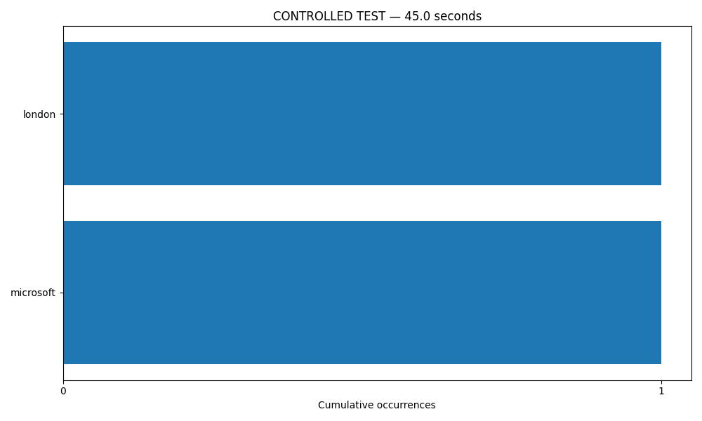
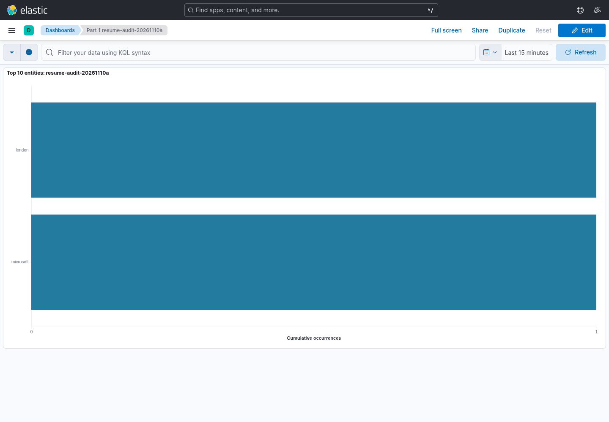

# CONTROLLED TEST ONLY

Source: http://127.0.0.1:43555/feed.xml
Latest runner invocation started: 2026-11-10T04:37:22.771598+00:00

Each elapsed time is measured from its own runner invocation, including startup and indexing delays. Absolute timestamps distinguish resumed sessions. Counts are cumulative, not sliding-window counts. The first RSS poll includes existing feed backlog.

## Observation 1: 45.0 seconds
Captured: 2026-11-10T04:37:09.253934+00:00; batch 0
Runner invocation started: 2026-11-10T04:36:22.249267+00:00

Leaders: london (1), microsoft (1)

## Observation 2: 45.0 seconds
Captured: 2026-11-10T04:38:08.409647+00:00; batch 0
Runner invocation started: 2026-11-10T04:37:22.771598+00:00

Leaders: london (1), microsoft (1)

Audit contains 1 acknowledged article records across this work directory. This is not a processed-article total; Spark and Elasticsearch can lag.

Interpretation requires reviewing the source articles: high counts indicate repeated mentions in sampled titles/summaries, not sentiment or public opinion. spaCy errors, entity aliases, repeated title/summary text, source coverage, initial backlog and processing lag limit the result. See producer/polls.jsonl to distinguish first-poll backlog from subsequent discoveries.
